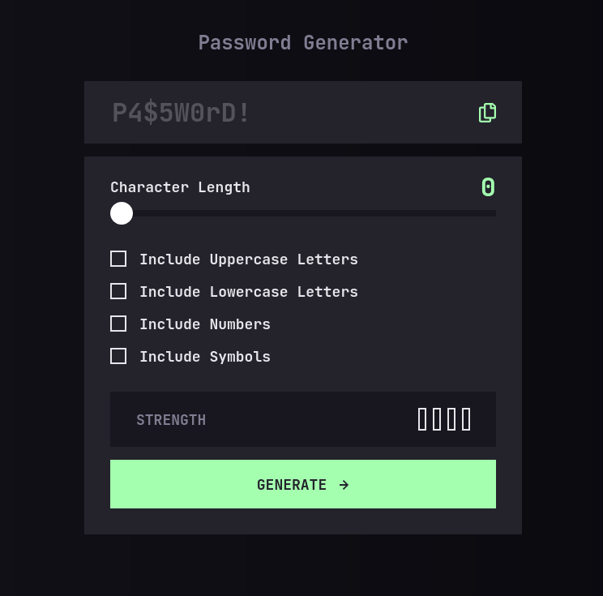

# Frontend Mentor - Password generator app solution

This is a solution to the [Password generator app challenge on Frontend Mentor](https://www.frontendmentor.io/challenges/password-generator-app-Mr8CLycqjh). Frontend Mentor challenges help you improve your coding skills by building realistic projects. 

## Table of contents

- [Overview](#overview)
  - [The challenge](#the-challenge)
  - [Screenshot](#screenshot)
  - [Links](#links)
- [My process](#my-process)
  - [Built with](#built-with)
  - [What I learned](#what-i-learned)
  - [Continued development](#continued-development)
  - [AI Collaboration](#ai-collaboration)
- [Author](#author)

## Overview

### The challenge

Users should be able to:

- Generate a password based on the selected inclusion options
- Copy the generated password to the computer's clipboard
- See a strength rating for their generated password
- View the optimal layout for the interface depending on their device's screen size
- See hover and focus states for all interactive elements on the page

### Screenshot



### Links

- Solution URL: [GitHub](https://github.com/ryanwells-rwc/password-generator)
- Live Site URL: [Vercel](https://password-generator-one-sandy-91.vercel.app/)

## My process

### Built with

- CSS custom properties
- Flexbox
- Mobile-first workflow
- [React](https://reactjs.org/) - JS library

### What I learned

I learned several things about development as I built this app.

- How to conditionally apply css classes to elements
```jsx
[0, 1, 2, 3].map((index) => (
        <div key={index} className={`rectangle ${index < strength ? 'filled' : ''}`}></div>
))
```
and how to use css custom properties to style elements
```scss
&[data-strength="1"] .filled {
  background-color: variables.$red-500;
}
```
- How to store options from selected checkboxes, and set the slider 
  length appropriately when more options are selected than the string is long
```jsx
const setOption = (key, value) => {
  setOptions(prev => {
    const next = { ...prev, [key]: value };
    const activeCount = Object.values(next).filter(Boolean).length;
    if (activeCount > length) {
      setLength(activeCount);
    }
    return next;
  });
};
```
- How to store random characters in an array based on the selections of 
  different options
```jsx
const guaranteed = [];
if (options.uppercase) guaranteed.push(charSets.uppercase[Math.floor(Math.random() * charSets.uppercase.length)]);
if (options.lowercase) guaranteed.push(charSets.lowercase[Math.floor(Math.random() * charSets.lowercase.length)]);
if (options.numbers) guaranteed.push(charSets.numbers[Math.floor(Math.random() * charSets.numbers.length)]);
if (options.symbols) guaranteed.push(charSets.symbols[Math.floor(Math.random() * charSets.symbols.length)]);
```
and how to shuffle those characters
```jsx
for (let i = guaranteed.length - 1; i > 0; i--) {
  const j = Math.floor(Math.random() * (i + 1));
  [guaranteed[i], guaranteed[j]] = [guaranteed[j], guaranteed[i]];
}
```

### Continued development

In the future I plan to learn more about managing data and possibly using 
reducers and even redux to accomplish this. I also plan to learn more about 
accessibility and how to make it work in more complex applications.

### AI Collaboration

I used the Junie agent within the Webstorm IDE to assist me in developing 
this app. It was useful for generating step by step lists of what tasks 
needed to be accomplished in order to get the app functioning as intended.

## Author

- Website - [Ryan Wells](https://www.ryanwells.io)
- Frontend 
  Mentor - [@ryanwells-rwc](https://www.frontendmentor.io/profile/ryanwells-rwc)
